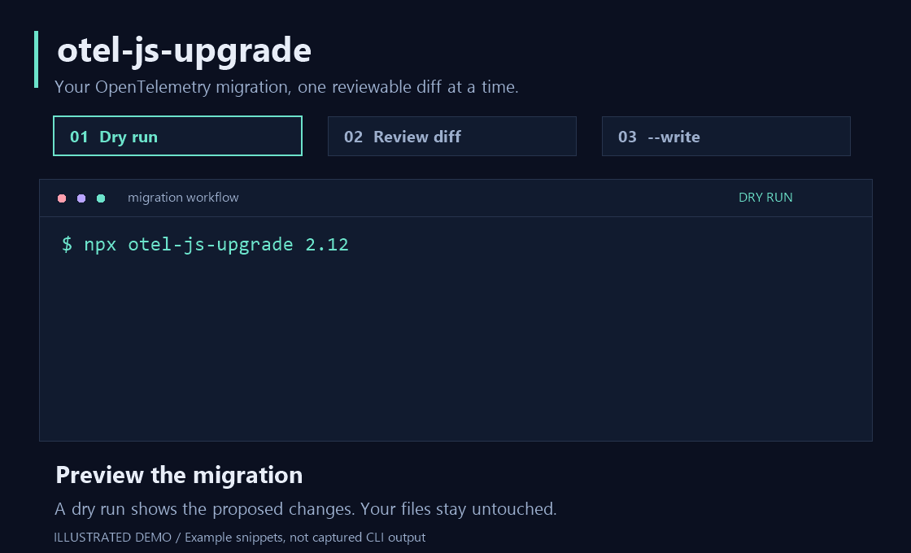

<div align="center">

# otel-js-upgrade

**A reviewable diff for your OpenTelemetry JavaScript migration.**

Preview the code moves, review what needs attention, and apply changes when you're ready.

`Dry run by default` · `Explicit --write` · `JavaScript & TypeScript`

[Quick start](#quick-start) · [Targets](#targets) · [Coverage](#what-it-rewrites) · [Limitations](#current-limitations) · [CLI reference](#cli-reference)

</div>



<p align="center"><em>Illustrated demo with example snippets; this is not a recording of real CLI output.</em></p>

> **Current release:** target `2.12` can apply the supported migration today. Target `3` is a preview: dry runs and `--check` work, but `3 --write` is blocked until a tool release enables writes after SDK 3.0.0 is released.

## Quick start

Run from the repository you want to migrate. The tool needs **Node 20.19 or newer**.

**1. Preview.** No files are written.

```sh
npx otel-js-upgrade 2.12
```

**2. Review.** Read the proposed diffs, todos, and notes. Resolve anything that needs manual attention.

**3. Apply.** Start with a clean Git tree, then explicitly opt in to writing.

```sh
npx otel-js-upgrade 2.12 --write
```

**4. Validate.** Follow the reported package-manager install instructions to update your lockfile, inspect the final diff, and run your project's checks.

By default, `--write` refuses uncommitted changes under the selected paths. `--allow-dirty` overrides that protection. Each rewritten code file is parsed again before it is written; if the rewritten file fails to parse, it stays unchanged and the run reports exit code `3`. Other files may still be processed; this is a per-file safeguard, not a transaction across the whole repository.

### A small example

Before:

```ts
import { BatchSpanProcessor } from '@opentelemetry/sdk-trace-base';

const processor = new BatchSpanProcessor(exporter, config);
```

After:

```ts
import { BatchSpanProcessor } from '@opentelemetry/sdk-trace';

const processor = new BatchSpanProcessor({ exporter, ...config });
```

The tool handles supported code moves and flags uncertain cases for review. A successful run can still contain todos; check the report before treating the migration as complete.

## Targets

```sh
npx otel-js-upgrade <target> [paths...] [options]
```

| Target | Code changes | package.json and write behavior |
| --- | --- | --- |
| `2.12` | Applies the supported moves that already work with SDK 2.12 packages. | Replaces `@opentelemetry/sdk-trace-base`, `sdk-trace-node`, and `sdk-trace-web` with `@opentelemetry/sdk-trace`; raises `core` and `resources` to `2.12.0`. Supports `--write`. |
| `3` | Previews the SDK 3.0 migration using the same code rules. | Currently leaves package.json alone and reports a todo. `3 --write` stops with exit code `2` and writes nothing. A later tool release will enable it after SDK 3.0.0 is released. |

`3.0` is also accepted as target `3`. The write block prevents rewritten code from importing `@opentelemetry/sdk-trace` without a matching dependency entry and avoids assigning final SDK 3 package versions before release.

Paths default to `.`. `node_modules`, build output, and anything Git ignores are skipped.

```sh
# Preview the future SDK 3 migration
npx otel-js-upgrade 3

# Scope a dry run to selected directories
npx otel-js-upgrade 2.12 src packages

# Fail CI when a supported change is pending
npx otel-js-upgrade 2.12 --check
```

| Requirement | Version |
| --- | --- |
| Running this codemod | Node `20.19+` |
| Running SDK 3.0 itself | Node `22.15+` |

You can run the codemod before upgrading Node. On older Node versions, the tool reminds you of SDK 3.0's requirement.

## What it rewrites

| Area | Supported change |
| --- | --- |
| Span processors | `new BatchSpanProcessor(exporter, config)` becomes `new BatchSpanProcessor({ exporter, ...config })`; `new SimpleSpanProcessor(exporter)` becomes `new SimpleSpanProcessor({ exporter })`. |
| `NodeSDK` options | `spanProcessor`, `metricReader`, and `logRecordProcessor` become their plural forms. |
| Provider registration | Supported `provider.register()` and `provider.register({ ... })` calls become global setters from `@opentelemetry/api`, preserving arguments and the order used by the 2.12 implementation for Node and browser setups. |
| Trace imports and types | Imports from `sdk-trace-base`, `sdk-trace-node`, and `sdk-trace-web` move to `@opentelemetry/sdk-trace`. `BasicTracerProvider`, `NodeTracerProvider`, and `WebTracerProvider` become `TracerProvider`, with their renamed config types. Names absent from the new package stay on the old package and get a flag. |
| OTLP Node configuration (target `3` only) | Named `OTLPExporterNodeConfigBase` imports and re-exports move from `@opentelemetry/otlp-exporter-base` to its public `/node-http` entry, preserving aliases and shared root exports such as `CompressionAlgorithm`. Target `2.12` stays unchanged. |
| Context managers | `AsyncHooksContextManager` becomes `AsyncLocalStorageContextManager`. |
| Dependencies | package.json changes follow the [target rules](#targets). |

<details>
<summary><strong>Supported import shapes and formatting</strong></summary>

Supported shapes include:

```ts
import { A } from '...';
import type { A } from '...';
const { A } = require('...');
const { A } = await import('...');
export { A } from '...';
import '...';
```

Rewritten declarations stay where they are, preserving their quotes, semicolons, and indentation. A new ES import goes after the last OpenTelemetry import; a new require goes after the first OpenTelemetry require.

</details>

## What it flags

When a detected case cannot be rewritten with certainty, the tool leaves that code alone and reports the file, line, and a migration-guide link.

| Severity | Meaning |
| --- | --- |
| `todo` | Action is needed before the SDK 3.0 migration will work. |
| `note` | The change can work, but there is something to review or know. |

**Todos cover:** packages still on SDK 1.x (the whole package is refused); the Jaeger propagator and exporter; environment variables no longer read by the SDK 3.0 provider; `forceFlushTimeoutMillis` and `generalLimits`; `register()` calls that cannot be expanded; types without a 3.0 equivalent; dependencies that pin SDK 2.x; deep imports into package build output; the removed OpenTracing and OpenCensus shims; `.vue` or `.svelte` files naming removed packages; and unsupported import shapes.

**Notes cover:** re-exports of renamed names that affect downstream users; `instanceof` checks on renamed provider classes that now match more broadly; global setters already called; and contrib packages whose 3.0-ready versions are not yet known.

## Current limitations

Coverage is deliberately bounded. Some cases get an explicit `manual-review` flag; others are not detected yet.

### Detected, but not rewritten

- Namespace and default imports (`import * as sdk`, `const sdk = require()`), `import x = require()`, inline `require('m').A`, `import().then(...)`, `export *`, and `import('m').A` in a type position.
- `sdk-node` namespaces such as `opentelemetry.tracing.X`, web-common utilities, removed `core` helpers, and, on target `3`, `sdk-logs` type aliases and the api-logs merge into `@opentelemetry/api`.
- `register()` in files where every OpenTelemetry module comes through `await import()`; it receives the same todo as other calls that cannot be expanded.
- `new BatchSpanProcessor(exporter, null)` and `new BatchSpanProcessor(exporter, void 0)`; these are flagged instead of rewritten.
- Namespace access and runtime `require()`/`import()` loads of `OTLPExporterNodeConfigBase` on target `3`; this configuration type needs manual review rather than a runtime value rewrite.

### Not detected or handled yet

- Merging new names into an existing import. The tool adds a declaration instead.
- `HttpInstrumentationConfig.serverName`, which SDK 3.0 removed.
- Node version checks in `engines`, Dockerfiles, and `.nvmrc`; the Prometheus exporter's new default host; and the boolean `setGlobalLoggerProvider` return.
- Reading `node_modules` to find third-party packages that pin SDK 2.x. The tool checks a built-in list instead.
- `NodeSDK` options written with computed keys, such as `['spanProcessor']: p`; these are left alone.

An exported span processor subclass without a constructor and a re-exported provider class receive a **note**, rather than a todo. The installed parser also cannot read some syntax, including `typeof import()` used as a call type argument; affected files stay unchanged with a parser todo.

## CLI reference

| Option | Behavior |
| --- | --- |
| `--write` | Apply changes. Without it, the default is a dry run that writes nothing. |
| `--json` | Print one JSON report on stdout and nothing else. |
| `--check` | Dry run; exit `1` if any change is pending. Intended for CI. |
| `--only <ids>` | Run only these rule IDs; comma-separated, repeatable. |
| `--skip <ids>` | Skip these rule IDs; comma-separated, repeatable. |
| `--ignore <glob>` | Add an ignore glob; repeatable. |
| `--no-package-json` | Leave package.json unchanged; equivalent to `--skip package-json`. |
| `--allow-dirty` | Allow `--write` with uncommitted changes under the selected paths. |
| `--verbose` | Also list unchanged files and reasons files were skipped. |
| `--no-color` | Disable color. Color is also off when `NO_COLOR` is set or stdout is not a TTY. |
| `--version`, `--help` | Show the version or usage. |

Rule IDs: `span-processor-options`, `nodesdk-plural-options`, `register`, `sdk-trace-imports`, `otlp-exporter-base` (target `3` only), `async-hooks-context-manager`, `package-json`.

`span-processor-options`, `register`, and `sdk-trace-imports` operate together; selecting one runs all three.

### Exit codes

| Code | Meaning |
| --- | --- |
| `0` | The run finished, with or without changes and flags. This does not mean every todo is resolved. |
| `1` | `--check` found at least one pending change. Flags alone do not trigger this code. |
| `2` | Usage error, parser load failure, `3 --write` while SDK 3 writes are blocked, or `--write` refused a dirty tree. Nothing was written. |
| `3` | A rewritten file failed parsing, a rule threw, or a file could not be written. Those files remain unchanged; the rest are processed. package.json is written last, only when every file under it was processed successfully; otherwise it remains unchanged with a todo. |

## Why this exists

A migration guide gives you a checklist. A codemod gives you a diff to review. The supported rewrites were checked against the 2.12.0 source and maintainers' migrations of real code. When the guide and source disagreed, source behavior took precedence.

See the [changelog](CHANGELOG.md) for release details and [open an issue](https://github.com/adityareddy-dev/otel-js-upgrade/issues) for a migration case the tool does not handle.

## License

[Apache-2.0](LICENSE)
